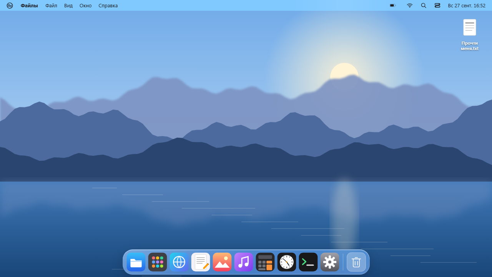
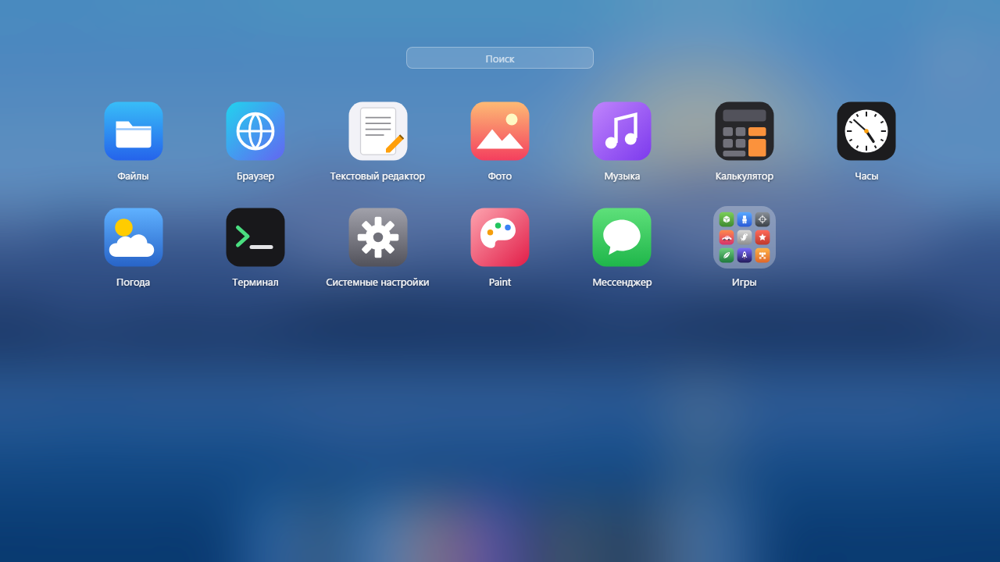
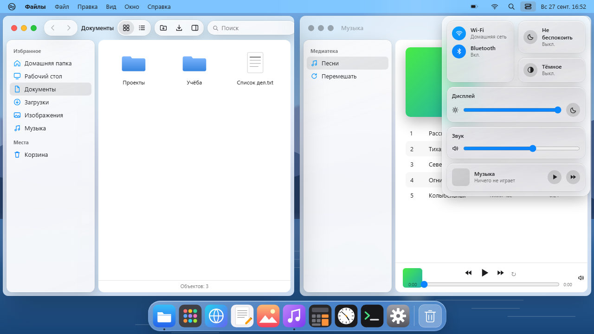

<div align="center">

# MacOSDemo - рабочий стол «Тахо»

**«Тахо» - рабочий стол в духе macOS, который целиком работает в браузере: строка меню, Dock, жидкое стекло, Mission Control, Launchpad, поиск и пункт управления. Без сервера, без интернета, без картинок и шрифтов из настоящей системы: значки и обои нарисованы кодом этого репозитория.**

[**▶ Открыть онлайн →**](https://alexalesha.github.io/MacOSDemo/) &nbsp;·&nbsp; [English version of this file](README.md)

[](#) [](https://github.com/ALEXalesha/MacOSDemo/actions/workflows/ci.yml) [](LICENSE) [](https://developer.mozilla.org/docs/Web/HTML) [](https://alexalesha.github.io/MacOSDemo/) [](https://claude.com/claude-code)

Код, тесты и документация этого проекта написаны Claude (Anthropic) в Claude Code. Идеи, проверка и решения - Алексей.

</div>

> Фан-концепт интерфейса. Не связан с Apple и не одобрен ею. macOS - товарный знак Apple Inc.







## Что умеет

- Строка меню с меню программ, Dock с увеличением и свёрнутыми окнами, раскладка окон у края экрана и от зелёной кнопки.
- Mission Control, Launchpad с папкой «Игры», поиск (Ctrl+Пробел), пункт управления, уведомления и центр с виджетами, экран блокировки.
- Файлы хранятся в браузере (IndexedDB); десять программ: Файлы, Браузер, Текстовый редактор, Фото, Музыка, Калькулятор, Часы, Погода, Терминал, Системные настройки, плюс Paint и Мессенджер.
- Листы вместо окон alert браузера; программы в фоне стоят на паузе.
- **Игры:** десять игр сборника [Hub](https://github.com/ALEXalesha/ALEXalesha.github.io) открываются
  в окне: «Кубический мир», «Блоксити», «Операция: Периметр», Horizon Drift, «Дино-бег», «Прыг-скок»,
  «Огненные джунгли», «Космический стрелок», «Блоки» и «Судоку». Каждая - свой репозиторий: на
  GitHub Pages окно загружает `../../<репозиторий>/` того же сайта (например,
  [AlexMine](https://alexalesha.github.io/AlexMine/)). У себя положите клоны игр рядом с этим
  репозиторием. Игра в свёрнутом или неактивном окне стоит на паузе (протокол - в
  `_os-shared/README.md`).


Рабочий стол лежит в `macos-tahoe/`, собирается из `macos-tahoe/src/` командой `node macos-tahoe/src/build.js`. `index.html` в корне просто открывает его.


## Запуск у себя

Откройте `index.html` или `macos-tahoe/index.html` в Chrome или Edge.

## Проверки

Законы Playwright в `tests/` открывают страницу по файловому адресу в безголовом Chromium, по
одной за раз:

```
npm install
npx playwright install chromium
npm test
```

Проверки окон игр идут, только если репозитории игр лежат рядом с этим, иначе они пропускаются.
Захват мыши в проверках всегда поддельный. Кадры выше сняты в безголовом браузере скриптом кадров сборника Hub.

## История

«Тахо» сделан в сборнике [Hub](https://github.com/ALEXalesha/ALEXalesha.github.io) (папки `web/macos-tahoe` и `web/_os-shared`), там он же открывается из Хаба. Здесь он лежит с историей коммитов, начиная после первого «сырого» импорта (в нём ещё были чужие названия продуктов и тексты); стартовая страница, таблица отдельно опубликованных игр и проверки добавлены для этой публикации.

## Лицензия

MIT, см. [LICENSE](LICENSE).
